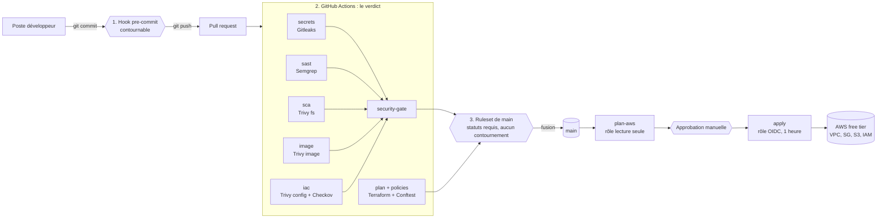

# Lab DevSecOps : une chaîne CI/CD qui bloque les changements vulnérables

> [!WARNING]
> **Dépôt de démonstration.** La branche `main` est saine. Le script `scripts/demo.sh` injecte à la demande des failles **volontaires et documentées** (`demo/bad.patch`). Les secrets utilisés sont factices et d'un format fictif (`LABFAKE_…`).

Une chaîne **GitHub Actions + Terraform (AWS free tier)** qui refuse la fusion d'un changement contenant un secret, une injection SQL, une dépendance ou une image vulnérable, un bucket public ou un security group ouvert.
Les contrôles reposent sur des outils gratuits qui reproduisent ce que fait Wiz CLI dans un pipeline, avec la correspondance outil par outil.
Le blocage est démontré sur trois couches : hook local, pipeline, protection de branche côté serveur.
Le déploiement AWS se fait par OIDC, sans aucune clé stockée, avec approbation manuelle.
Tout se rejoue en local avec Docker et `make`, sans compte AWS.

## Rejouer la démo (sans compte AWS)

Prérequis : Docker, `make`, `bash`. Sous Windows : WSL2.

```bash
git clone https://github.com/Gachtout/Lab-CI-CD.git && cd Lab-CI-CD
make demo-good   # dépôt sain : 9 contrôles passent
make demo-bad    # failles injectées : 8 contrôles bloquent
```

Le premier lancement télécharge les images d'outils (environ 3,5 Go) ; les suivants prennent une trentaine de secondes. Si Docker Hub limite le débit : `make demo-good DOCKERHUB=mirror.gcr.io`.

```text
==> Synthèse                         ==> Synthèse
  PASSE  tests                         BLOQUE tests
  PASSE  secrets                       BLOQUE secrets
  PASSE  sast                          BLOQUE sast
  PASSE  sca                           BLOQUE sca
  PASSE  image                         BLOQUE image
  PASSE  iac-trivy                     BLOQUE iac-trivy
  PASSE  iac-checkov                   BLOQUE iac-checkov
  PASSE  policy                        BLOQUE policy
  PASSE  exceptions                    PASSE  exceptions
        make demo-good                       make demo-bad
```

<!-- Captures à ajouter (voir docs/reference/captures.md), puis décommenter :


-->

## Architecture



## Ce que chaque contrôle bloque

| Contrôle | Outil | Bloque si… | Équivalent Wiz |
|---|---|---|---|
| Secrets | Gitleaks | un secret est trouvé, toujours | Détection de secrets (`wizcli dir scan`) |
| Code (SAST) | Semgrep CE | constat de sévérité `ERROR` | Wiz Code |
| Dépendances (SCA) | Trivy fs | `HIGH`/`CRITICAL` avec correctif | `wizcli dir scan` |
| Image | Trivy image | `HIGH`/`CRITICAL` avec correctif, exécution en root | `wizcli docker scan` |
| IaC | Trivy config, Checkov | mauvaise configuration non exemptée | `wizcli iac scan` |
| Policies maison | Conftest (Rego) | bucket public, entrée `0.0.0.0/0`, tags manquants, ressource payante | Règles personnalisées en Rego |
| Exceptions | script | exception sans justification, sans date, ou expirée | Ignore rules |

## Documentation

Le parcours complet est dans [`docs/`](docs/index.md) (site MkDocs Material) : une page par étape, avec le concept expliqué depuis zéro, les sorties réelles et un exercice « casse-le volontairement ».

| | |
|---|---|
| [Parcours en 11 étapes](docs/index.md) | [Correspondance Wiz ↔ gratuit](docs/reference/mapping-wiz.md) |
| [Limites face à Wiz](docs/reference/limites.md) | [Leçons apprises](docs/reference/lecons-apprises.md) |
| [Ce que je ferais en production](docs/reference/en-production.md) | [Décisions d'architecture](docs/adr/0001-architecture.md) |
| [Points de contrôle manuels](docs/reference/checkpoints.md) | [Audit du lab précédent](docs/00-audit.md) |

## Organisation du dépôt

```text
app/                 API Flask, tests, Dockerfile
terraform/
  modules/           vpc, security_group, s3, iam (ressources gratuites uniquement)
  envs/dev/          environnement déployé
  bootstrap/         état S3, OIDC, rôles, budget (appliqué une fois, à la main)
policies/            règles Rego appliquées au plan Terraform, avec leurs tests
.github/workflows/   pr-security, terraform-plan, deploy, destroy
.github/rulesets/    protection de la branche main
scripts/             démo, synthèse, exceptions, configuration GitHub
demo/bad.patch       les failles de démonstration
docs/                site MkDocs, ADR
Makefile             toutes les commandes, en images Docker épinglées par digest
```

`make help` liste les cibles.

## État de vérification

| Élément | État |
|---|---|
| Contrôles locaux, démo good et bad, policies et leurs tests | Exécutés |
| Workflow `pr-security` | Exécuté sur GitHub : 11 jobs verts |
| Workflows `terraform-plan`, `deploy`, `destroy` | Validés par actionlint, **pas encore exécutés** |
| Ruleset et script de configuration GitHub | Syntaxe validée, **pas encore appliqués** |
| Terraform AWS (bootstrap et dev) | `validate` et plan hors ligne, **jamais appliqué sur AWS** |

## Licence

[MIT](LICENSE). Application volontairement minimale : ne pas s'en servir comme base de production.
