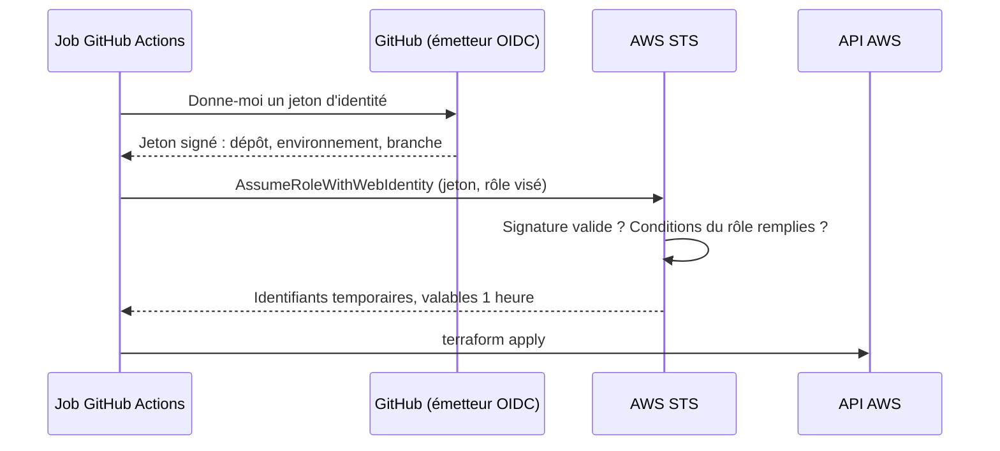

# Étape 10 : OIDC, apply et destroy sur AWS

!!! warning "Non exécuté par l'auteur du lab"
    Aucune commande de cette étape n'a été lancée contre un compte AWS. Le code Terraform est validé (`terraform validate`) et planifié hors ligne (14 ressources pour le bootstrap, 15 pour `dev`) ; les workflows passent `actionlint`. Les politiques IAM en moindre privilège n'ont **pas** été éprouvées : attends-toi à corriger un ou deux `AccessDenied` au premier `apply`. La section [Dépannage](#depannage) explique comment.

## Objectif

Déployer l'infrastructure depuis GitHub Actions, sans stocker la moindre clé AWS, avec une validation humaine avant tout changement.

## Le concept, depuis zéro

**Le problème des clés statiques.** La méthode historique consiste à créer un utilisateur IAM, générer une clé d'accès et la coller dans les secrets GitHub. Cette clé ne périme jamais, fonctionne depuis n'importe où, et donne ses droits à quiconque la lit : un workflow modifié, une action tierce compromise, un journal trop bavard.

**L'idée d'OIDC : prouver qui on est, au lieu de détenir un secret.**



1. Le job demande à GitHub un jeton. GitHub le **signe** et y inscrit des faits qu'il certifie : quel dépôt, quel environnement.
2. Le job présente ce jeton à AWS en demandant un rôle.
3. AWS vérifie la signature, puis la **politique de confiance** du rôle : elle dit quels jetons sont acceptés.
4. AWS renvoie des identifiants qui expirent au bout d'une heure.

Rien n'est stocké dans GitHub. Il n'y a rien à voler, ni à faire tourner.

**Toute la sécurité tient dans la politique de confiance.** Celle du lab compare le champ `sub` du jeton en **égalité stricte** :

```hcl
condition {
  test     = "StringEquals"
  variable = "token.actions.githubusercontent.com:sub"
  values   = ["repo:${var.github_repository}:environment:dev"]
}
```

L'erreur classique est d'écrire `StringLike` avec `repo:mon-org/*` : n'importe quel dépôt de l'organisation, n'importe quelle branche, n'importe quelle PR peut alors endosser le rôle.

**Deux rôles, deux environnements.**

| Environnement GitHub | Rôle AWS | Droits | Approbation |
|---|---|---|---|
| `dev-plan` | `devsecops-lab-gha-plan` | Lecture seule | Aucune |
| `dev` | `devsecops-lab-gha-deploy` | Créer et supprimer les ressources du lab | **Manuelle** |

Les deux environnements n'acceptent que la branche `main`. Une PR n'obtient donc jamais d'identifiants AWS : son plan reste celui, hors ligne, de l'étape 6.

**L'état distant.** L'état Terraform contient la description complète de l'infrastructure. Il vit dans un bucket S3 privé, chiffré et versionné. Le verrou est un fichier `.tflock` dans ce bucket (`use_lockfile`), ce qui évite la table DynamoDB des anciennes configurations.

## Ce qu'on fait

- `terraform/bootstrap/` : bucket d'état, fournisseur OIDC, les deux rôles, la limite de permissions des rôles applicatifs, une alerte de budget à 1 $. Appliqué **une fois, à la main**, avec un état local : il crée ce dont tout le reste dépend.
- `deploy.yml` : sur `main`, job `plan-aws` (lecture seule) puis job `apply`, qui attend l'approbation.
- `destroy.yml` : lancement manuel, il faut taper `destroy`, puis approuver.
- Cibles `make aws-plan`, `aws-apply`, `aws-destroy`. Les deux dernières refusent de s'exécuter sans `AWS_CONFIRM=oui`.

Le moindre privilège du rôle de déploiement, en trois mesures :

- actions réseau limitées à VPC, sous-réseau et security group, dans une seule région (ni instance, ni NAT Gateway : l'action n'est pas accordée) ;
- actions S3 et IAM limitées aux ressources dont le nom commence par `devsecops-lab-` ;
- **limite de permissions** : il ne peut créer un rôle applicatif que si ce rôle porte la politique `devsecops-lab-app-boundary`. Sans cela, un rôle autorisé à créer des rôles peut s'en créer un plus puissant que lui.

## Bootstrap : les commandes à lancer toi-même

Prérequis : un compte AWS, un utilisateur administrateur configuré en local (`aws configure sso` de préférence), Terraform ≥ 1.10 installé sur ton poste.

| # | Commande | Ce qu'elle fait |
|---|---|---|
| 1 | `aws sts get-caller-identity` | Vérifie quel compte et quelle identité tu utilises. Ne modifie rien |
| 2 | `cd terraform/bootstrap && cp terraform.tfvars.example terraform.tfvars` | Crée ton fichier de variables (ignoré par git). Renseigne ton dépôt et ton courriel |
| 3 | `terraform init` | Télécharge le provider AWS. Ne touche pas au compte |
| 4 | `terraform plan -out=bootstrap.tfplan` | Affiche les 14 ressources à créer. **Lis-le.** Ne crée rien |
| 5 | `terraform apply bootstrap.tfplan` | Crée le bucket d'état, le fournisseur OIDC, les deux rôles, la limite de permissions et le budget |
| 6 | `terraform output` | Affiche les cinq valeurs à reporter dans GitHub |

Puis reporte les sorties dans les **variables** du dépôt (ce ne sont pas des secrets : un ARN n'ouvre aucun droit) :

```bash
gh variable set AWS_REGION          --body "$(terraform output -raw region)"
gh variable set TF_STATE_BUCKET     --body "$(terraform output -raw state_bucket)"
gh variable set AWS_PLAN_ROLE_ARN   --body "$(terraform output -raw plan_role_arn)"
gh variable set AWS_DEPLOY_ROLE_ARN --body "$(terraform output -raw deploy_role_arn)"
gh variable set APP_BOUNDARY_ARN    --body "$(terraform output -raw app_boundary_arn)"
```

Conserve `terraform.tfstate` du bootstrap en lieu sûr (il ne contient pas de secret, mais il est nécessaire pour modifier ou détruire le bootstrap).

Si ton compte possède déjà un fournisseur OIDC pour GitHub, l'étape 5 échouera sur cette ressource : il ne peut en exister qu'un par URL. Importe-le avec `terraform import aws_iam_openid_connect_provider.github <arn>`.

## Comment vérifier

1. Fusionne une PR qui touche `terraform/`. Le workflow `deploy` démarre.
2. Le job `plan-aws` affiche le plan réel dans le résumé de l'exécution.
3. Le job `apply` passe en attente : **Review deployments**, puis approuve.
4. Après l'apply : `aws s3 ls | grep devsecops-lab-data` et `aws ec2 describe-vpcs --filters Name=tag:Project,Values=devsecops-lab`.
5. Dans CloudTrail, cherche l'événement `AssumeRoleWithWebIdentity` : tu y lis le `sub` du jeton et le nom de session `gha-apply-<run_id>`. C'est la piste d'audit qui relie un changement AWS à une exécution GitHub.
6. Nettoyage : workflow `destroy`, tape `destroy`, approuve.

## Casse-le volontairement

- **Depuis une branche.** Lance `deploy` par `workflow_dispatch` depuis une autre branche que `main`. Attendu : l'environnement refuse le déploiement, avant toute demande de jeton.
- **Politique de confiance.** Dans le bootstrap, remplace `environment:dev` par `environment:prod` pour le rôle de déploiement, réapplique, relance `deploy`. Attendu : `Not authorized to perform sts:AssumeRoleWithWebIdentity`. Le jeton est valide, mais il ne dit pas ce que le rôle exige. Remets la valeur d'origine.
- **Moindre privilège.** Ajoute une ressource `aws_nat_gateway` dans `envs/dev`. La policy `COST-01` la refuse dès la PR. Si tu forces le passage, l'apply échoue quand même : le rôle n'a pas l'action `ec2:CreateNatGateway`. Deux barrières indépendantes.
- **Verrou.** Lance `deploy` deux fois de suite : le second attend le premier (`concurrency`), et Terraform refuserait de toute façon de prendre un état verrouillé.

## Dépannage

Un `AccessDenied` au premier apply est probable : la liste d'actions a été écrite à partir de la documentation, pas d'une exécution.

1. Lis le message : il nomme l'action refusée (`… is not authorized to perform: s3:PutBucketAcl on resource …`).
2. Ajoute **cette action seulement** au bon bloc de `terraform/bootstrap/oidc.tf`, sur la ressource la plus étroite possible.
3. Réapplique le bootstrap, relance le workflow.

Ne cède pas à `"Action": "*"` : c'est précisément l'exercice. Note chaque ajout, c'est de la matière pour la page « Leçons apprises ».

## Côté Wiz, en entreprise

| Ici | Avec Wiz |
|---|---|
| Rôle OIDC pour Terraform | Inchangé : c'est l'affaire de la plateforme CI, pas de Wiz |
| Authentification de l'outil de scan | `wizcli` s'authentifie avec un **compte de service** Wiz (identifiant et secret) stocké dans les secrets de la CI. C'est un secret statique : à faire tourner et à restreindre au seul droit de scanner |
| Politique de confiance trop large | Wiz la détecte après coup : rôle endossable par une identité externe, chemin d'attaque vers des données sensibles |
| Alerte de budget | Hors périmètre de Wiz |

Le point à retenir pour la mission : Wiz saura dire qu'un rôle de pipeline est trop permissif **une fois qu'il existe**. Le concevoir correctement reste un travail d'ingénierie, celui de cette étape.
