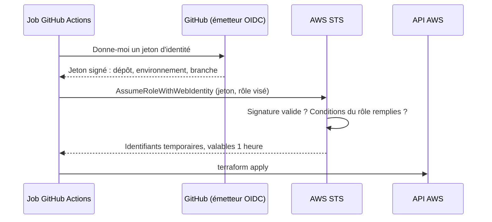

# Étape 10 : OIDC, apply et destroy sur AWS

!!! warning "Vérification statique uniquement"
    `make check-etape-10` planifie ton bootstrap **hors ligne**, avec de faux identifiants, et lit tes fichiers. Il n'exécute aucune cible `aws-*` et n'agit sur aucun compte.

    | Vérifié par le check | À tester toi-même sur AWS et GitHub |
    |---|---|
    | Le bootstrap se planifie et crée le fournisseur d'identité, le bucket d'état protégé, le budget | `terraform apply` du bootstrap réussit sur ton compte |
    | La politique de confiance compare le sujet strictement et vérifie l'audience (lecture du code) | Un job hors environnement, ou depuis une autre branche, est **refusé** par AWS |
    | Aucune clé statique dans les workflows ; les jobs AWS sont dans un environnement | L'approbation manuelle bloque réellement l'apply |
    | Aucune politique n'accorde toutes les actions (lecture du code) | Le rôle de déploiement a **assez** de droits pour l'apply, et pas plus |
    | Les cibles `aws-apply` et `aws-destroy` exigent une confirmation | `destroy` supprime tout, et le budget t'alerte |

    Le moindre privilège ne se prouve pas en statique : attends-toi à corriger des refus d'accès au premier apply. C'est l'exercice.

## Objectif

Déployer l'infrastructure depuis GitHub Actions, sans stocker la moindre clé AWS, avec une validation humaine avant tout changement.

## Le concept, depuis zéro

**Le problème des clés statiques.** La méthode historique consiste à créer un utilisateur IAM, générer une clé d'accès et la coller dans les secrets GitHub. Cette clé ne périme jamais, fonctionne depuis n'importe où, et donne ses droits à quiconque la lit : un workflow modifié, une action tierce compromise, un journal trop bavard.

**L'idée d'OIDC : prouver qui on est, au lieu de détenir un secret.**



1. Le job demande à GitHub un jeton. GitHub le **signe** et y inscrit des faits qu'il certifie : quel dépôt, quel environnement.
2. Le job présente ce jeton à AWS en demandant un rôle.
3. AWS vérifie la signature, puis la **politique de confiance** du rôle : elle dit quels jetons sont acceptés.
4. AWS renvoie des identifiants qui expirent au bout d'une heure.

Rien n'est stocké dans GitHub. Il n'y a rien à voler, ni à faire tourner.

**Toute la sécurité tient dans la politique de confiance.** Celle du lab compare le champ `sub` du jeton en **égalité stricte** :

L'erreur classique est d'écrire `StringLike` avec `repo:mon-org/*` : n'importe quel dépôt de l'organisation, n'importe quelle branche, n'importe quelle PR peut alors endosser le rôle.

**Deux rôles, deux environnements.**

| Environnement GitHub | Rôle AWS | Droits | Approbation |
|---|---|---|---|
| `dev-plan` | `devsecops-lab-gha-plan` | Lecture seule | Aucune |
| `dev` | `devsecops-lab-gha-deploy` | Créer et supprimer les ressources du lab | **Manuelle** |

Les deux environnements n'acceptent que la branche `main`. Une PR n'obtient donc jamais d'identifiants AWS : son plan reste celui, hors ligne, de l'étape 6.

**L'état distant.** L'état Terraform contient la description complète de l'infrastructure. Il vit dans un bucket S3 privé, chiffré et versionné. Le verrou est un fichier `.tflock` dans ce bucket (`use_lockfile`), ce qui évite la table DynamoDB des anciennes configurations.

## Ce qui t'est fourni

- Les cibles `aws-plan`, `aws-apply`, `aws-destroy`, vides.
- Ton module IAM et ton environnement `dev` de l'étape 6.

## Énoncé

Livrables :

- `terraform/bootstrap/` : bucket d'état, fournisseur d'identité, rôles, alerte de budget. État local, appliqué à la main.
- Les workflows `deploy.yml` et `destroy.yml`.
- Les cibles `make aws-plan`, `make aws-apply`, `make aws-destroy`.

Contraintes :

1. Le bootstrap se planifie hors ligne et crée un fournisseur d'identité pour l'émetteur de jetons de GitHub Actions.
2. La politique de confiance des rôles compare le sujet du jeton en égalité stricte, sans joker, et le lie à un environnement GitHub.
3. L'audience du jeton est vérifiée : seule celle d'AWS STS est acceptée.
4. Le bucket d'état est versionné, chiffré, et bloque tout accès public.
5. Une alerte de budget est créée.
6. Aucune clé d'accès AWS statique n'apparaît dans un workflow : les jobs obtiennent leurs identifiants par fédération d'identité.
7. Tout job qui obtient des identifiants AWS s'exécute dans un environnement GitHub. La destruction est manuelle et vérifie une confirmation saisie.
8. Le déploiement ne peut pas être déclenché par une pull request ; en automatique, il ne part que de `main`.
9. Aucune politique du bootstrap n'accorde toutes les actions.
10. `make aws-apply` et `make aws-destroy` refusent de s'exécuter sans la variable `AWS_CONFIRM`.

## Contrat d'interface

Ces noms sont imposés : la vérification en dépend.

| Élément | Valeur imposée |
|---|---|
| Bootstrap | `terraform/bootstrap/`, variables `github_repository`, `budget_email`, `offline` |
| Workflows | `.github/workflows/deploy.yml`, `.github/workflows/destroy.yml` |
| Cibles `make` | `aws-plan`, `aws-apply`, `aws-destroy` |
| Confirmation locale | variable d'environnement `AWS_CONFIRM` |
| Configuration du dépôt | des *variables* GitHub (pas des secrets) pour la région, le bucket d'état et les ARN des rôles |

## Critère de réussite

```bash
make check-etape-10
```

Chaque ligne `ECHEC [Cn]` renvoie à la contrainte `n` ci-dessus et donne l'emplacement en cause, jamais la correction. Les journaux détaillés sont dans `reports/checks/`. Teste toujours en local avant de pousser.

## Indices

Ouvre-les dans l'ordre, et seulement après avoir cherché.

??? tip "Indice 1 : par où commencer"
    - Le bootstrap crée ce dont le reste dépend : il ne peut pas utiliser l'état distant qu'il crée lui-même.
    - Dans la fédération d'identité, toute la sécurité tient dans la politique de confiance du rôle.

??? tip "Indice 2 : les points qui coincent"
    - Le jeton de GitHub contient un champ sujet dont la forme dépend du contexte du job (branche, PR, environnement). Lis la documentation « OpenID Connect » de GitHub.
    - Un rôle pour lire, un rôle pour écrire : deux environnements GitHub, dont un seul exige une approbation.
    - Un rôle autorisé à créer des rôles peut s'en créer un plus puissant que lui. Cherche « permissions boundary ».
    - Un job demande un jeton d'identité grâce à un droit spécifique du jeton de workflow.

??? tip "Indice 3 : presque la réponse"
    - Deux conditions d'égalité dans la politique de confiance : l'audience, et le sujet au format dépôt puis environnement.
    - L'identifiant du compte peut se déduire de l'ARN du fournisseur d'identité, sans source de données distante : le bootstrap reste planifiable hors ligne.
    - Restreins les actions du rôle de déploiement par service, par préfixe de nom de ressource, et par région.
    - L'action officielle d'AWS échange le jeton contre des identifiants ; elle reçoit l'ARN du rôle et la région.
    - Le backend se configure à l'initialisation par des options, à partir de variables d'environnement.
    - La cible d'apply commence par tester la variable de confirmation et s'arrête si elle manque.

## Casse-le volontairement

Note ce que tu observes dans `docs/journal.md` : ce sont tes sorties, pas celles d'un corrigé.

1. Lance le déploiement depuis une autre branche que `main`. À quel niveau est-il refusé ?
2. Change l'environnement attendu dans la politique de confiance, réapplique, relance. Lis le message d'AWS.
3. Ajoute une NAT Gateway : la policy la refuse en PR. Si tu forçais le passage, que ferait AWS ?
4. Cherche dans CloudTrail l'événement d'échange de jeton : qu'y lis-tu qui relie AWS à une exécution GitHub ?

## Défends ton choix

À savoir expliquer à l'oral, sans notes.

1. Pourquoi une clé d'accès statique dans les secrets de CI est-elle un mauvais choix ?
2. Décris l'échange OIDC en quatre étapes. Qui signe quoi, qui vérifie quoi ?
3. Que se passe-t-il si la condition sur le sujet utilise une comparaison par motif avec un joker ?
4. Pourquoi deux rôles plutôt qu'un ?
5. À quoi sert une limite de permissions ? Décris l'élévation de privilèges qu'elle empêche.
6. Pourquoi le plan d'une PR n'a-t-il pas d'identifiants, alors que celui du déploiement en a ?
7. Un `AccessDenied` au premier apply : quelle est ta méthode, et quelle est la tentation à refuser ?
8. Pourquoi les ARN des rôles sont-ils des variables et pas des secrets ?

## Côté Wiz, en entreprise

| Ici | Avec Wiz |
|---|---|
| Rôle OIDC pour Terraform | Inchangé : c'est l'affaire de la plateforme CI, pas de Wiz |
| Authentification de l'outil de scan | `wizcli` s'authentifie avec un **compte de service** Wiz (identifiant et secret) stocké dans les secrets de la CI. C'est un secret statique : à faire tourner et à restreindre au seul droit de scanner |
| Politique de confiance trop large | Wiz la détecte après coup : rôle endossable par une identité externe, chemin d'attaque vers des données sensibles |
| Alerte de budget | Hors périmètre de Wiz |

Le point à retenir pour la mission : Wiz saura dire qu'un rôle de pipeline est trop permissif **une fois qu'il existe**. Le concevoir correctement reste un travail d'ingénierie, celui de cette étape.

## Corrigé

À ouvrir seulement une fois `make check-etape-10` vert et les questions travaillées : [`etape-10-solution`](https://github.com/Gachtout/Lab-CI-CD/tree/etape-10-solution). La version finale de tout le parcours est sur la branche [`solution`](https://github.com/Gachtout/Lab-CI-CD/tree/solution).

Corrections apportées plus tard à ce corrigé :

- Aucune : c'est la dernière version du bootstrap. Les politiques IAM du corrigé n'ont jamais été appliquées sur un compte réel.
